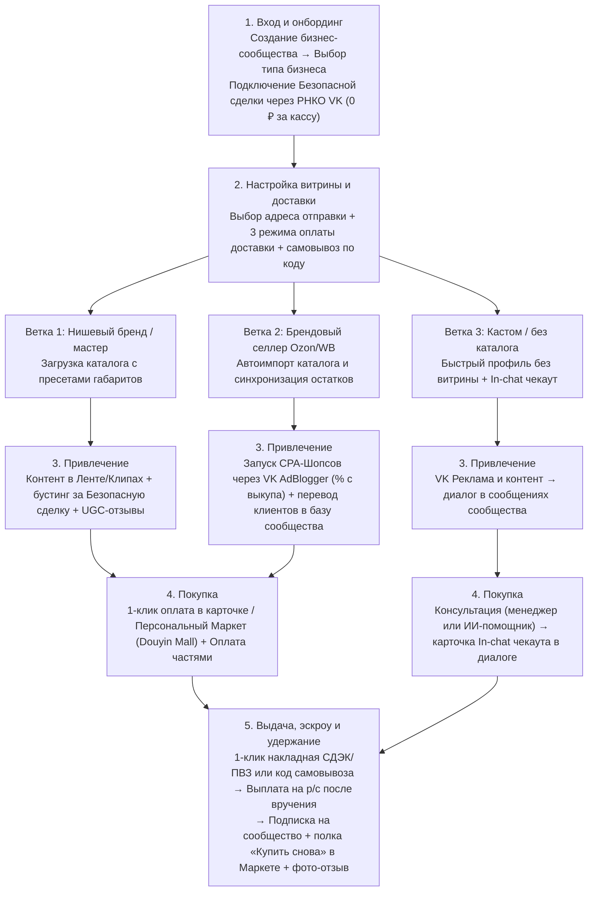

# Стратегия развития социальной коммерции для бизнес-сообществ ВКонтакте

> **Коротко о сути документа:** единая продуктово-коммерческая стратегия для отборочного этапа VK Case Champ 2026. Написана простым и понятным языком — без сложного финансового жаргона — так, чтобы её мог прочитать любой участник команды, дизайнер презентации или эксперт со стороны бизнеса.

---

## Главное в одном абзаце (Executive Summary)

ВКонтакте не нужно превращаться в «ещё один Ozon» со складами, пунктами выдачи и дешёвыми однотипными товарами. Сильная сторона ВКонтакте — **прямые продажи от брендов, нишевых магазинов и мастеров через контент, рекомендации блогеров и живое общение**, где бизнес сохраняет свою аудиторию и маржу.  

Чтобы превратить огромный товарный трафик в реальные заказы внутри платформы, мы предлагаем **пять взаимосвязанных шагов**:
1. **Разделить два контура:** дешёвый массовый спрос («розетки и бытовая мелочёвка» со средним чеком ~1 000 ₽) остаётся во внешнем контуре партнёрского маркетплейса, а внутрь ВКонтакте привлекаются нишевые бренды, мастера и брендовые селлеры (средний чек ~3 800 ₽).
2. **Пересобрать вкладку «Маркет ВКонтакте» по модели китайского Douyin Mall:** убрать холодную общую витрину с чужими карточками и сделать **персональный центр дожима и повторных покупок** (товары из просмотренных Клипов и Ленты, новинки подписок, повторные заказы) с переключателем «Только быстрая покупка».
3. **Починить «последний метр» покупки:** заменить сложную покупку собственной онлайн-кассы на **агентский чек от VK + Безопасную сделку** (деньги замораживаются до вручения посылки), запустить **автоматическую доставку в 1 клик** (СДЭК / Почта / Boxberry + самовывоз по коду) и **оформление заказа прямо в чате** (модель WeChat).
4. **Развернуть уже готовый двигатель «Шопсов» на собственные магазины VK:** открыть CPA-биржу `VK AdBlogger` (оплата авторам `%` с подтверждённой продажи) для бизнес-сообществ ВКонтакте — сейчас она работает только на внешний маркетплейс.
5. **Запустить не-рекламную монетизацию без вреда для рекламы:** комиссия за Безопасную сделку (`2–4%`) с условным рекламным кэшбэком за рост оборота и быструю отгрузку, «Оплата частями» под высокий чек, подписка на автоматизацию и ИИ-помощника в чатах, а также сервисный сбор в CPA-Шопсах.

---

## 1. Почему стратегия нужна именно сейчас: факты из данных

Ежемесячная аудитория ВКонтакте составляет **93 млн человек**, а сервисы экосистемы VK охватывают **97% пользователей рунета** ([отчётность VK за 3 кв. 2026 г.](https://corp.vkcdn.ru/media_s3/corp-site-prod/files/rus_results_presentation_q3_2026.pdf)). По итогам 2025 года выручка холдинга составила **160 млрд ₽**, из них **37,7 млрд ₽** принесла реклама малого и среднего бизнеса ([пресс-релиз VK по МСФО за 2025 г.](https://vk.company/ru/press/releases/12255/)). При этом прямая выручка от социальной коммерции составила всего **1,3 млрд ₽** ([Интерфакс](https://www.interfax.ru/business/1078767)) — меньше `1%` доходов компании, хотя товарный контент уже собирает десятки миллиардов просмотров ([блог ВКонтакте](https://m.vk.ru/press/shops-2025)).

Месячный срез данных по платформе показывает **четыре системных разрыва**:

1. **Деньги утекают наружу или в переписку.** За месяц товары во ВКонтакте увидели **66,6 млн человек**. Через партнёрский маркетплейс (прообраз — интеграция с Ozon) прошло **4,93 млн заказов** на **5,12 млрд ₽** со средним чеком **1 039 ₽**. Через собственный чекаут (корзину) ВКонтакте оформили **413,7 тыс. заказов** на **1,56 млрд ₽** со средним чеком **3 781 ₽** — в **3,6 раза выше**, чем у партнёра. Но из этих 413,7 тыс. оформленных заказов **онлайн внутри ВКонтакте оплатили лишь 4 903 заказа (`1,19%`)**. Остальные `98,81%` ушли в переписки, внешние ссылки или отмены *(важно: `3 781 ₽` — это средний чек именно оформленных через корзину заказов, а не только оплаченных онлайн)*.
2. **У магазинов почти нет оплаты и доставки.** Среди товарных бизнес-сообществ (`4 055` в выборке) каталог загрузили `99,6%`, корзину включили `92,1%`, но **доставку подключили лишь `19,3%`**, **онлайн-оплату — `5,1%` (`206` групп)**, а **и оплату, и доставку одновременно — всего `2,4%` (`97` групп)**. Причина подтверждена проверкой официальной справки VK:
   * для автоматических чеков по закону 54-ФЗ ИП и ООО обязаны отдельно покупать и вручную настраивать через XML-файлы **только одну облачную кассу — АТОЛ Онлайн** ([справка VK Pay 40012](https://id.vk.ru/about/faq/business/vkpay/fiscalization/40012), [40013](https://id.vk.ru/about/faq/business/vkpay/fiscalization/40013)), что стоит бизнесу `27–45 тыс. ₽ в год` независимо от продаж;
   * в VK Pay нет защиты покупателя (удержания денег до получения посылки): ИП и ООО получают деньги на 3-й рабочий день после оплаты, а самозанятые — моментально на кошелёк ([справка VK Pay 40005](https://id.vk.ru/about/faq/business/vkpay/how_does_it_work/40005), [40006](https://id.vk.ru/about/faq/business/vkpay/how_does_it_work/40006));
   * если продавец не заполнил точный вес и габариты товара, авторасчёт доставки ломается и покупатель видит заглушку *«Стоимость уточняйте у продавца»*, а сама инструкция «Магазина 2.0» прямо советует договориться об оплате в личных сообщениях и вручную вписывать трек-номер ([инструкция VK по доставке](https://vk.ru/@business-instrukciya-po-dostavke)).
3. **Главная страница Маркета ВКонтакте не работает как «клон маркетплейса».** На Главную Маркета приходится всего **`0,2%`** открытий карточек собственных магазинов (`412,8 тыс.` из `193,5 млн`) и **`0,1%`** открытий карточек партнёра (`88,4 тыс.`). Средняя дневная аудитория витрины — всего `127,4 тыс.` человек. Реальные точки входа — это **Витрина самого сообщества (`39,1%`)**, **Лента и Клипы (`18,6%` у своих магазинов и `92,7%` у партнёра)**, а также переходы из чатов, историй и ссылок (`40,2%`).
4. **Товарный контент проигрывает обычному, а «Шопсы» работают только на чужой маркетплейс.** Посты с прикреплёнными товарами выкладывают всего `4,5%` товарных групп, клипы — `1,6%`, а вовлечённость (лайки к просмотрам) у товарного контента в **2,6 раза ниже**, чем у обычного. Одновременно в бирже блогеров [VK AdBlogger](https://adblogger.vk.ru/shops) уже работает сильный инструмент **«Шопсы»** (`>135 тыс.` авторов, оплата процентом с продаж, 20-дневная проверка возвратов, бесплатные образцы, автомаркировка рекламы) — но сегодня он подключён **только к каталогу Ozon** и закрыт для собственных магазинов ВКонтакте.

---

## 2. Место ВКонтакте на рынке (Вопрос 1)

> **Позиционирование:** ВКонтакте — **главная в России легальная площадка прямых брендовых продаж (D2C — «напрямую от бренда покупателю») через контент, рекомендации авторов и живое комьюнити**, где бизнес строит собственную базу клиентов и сохраняет маржу.

ВКонтакте не конкурирует в лоб за доставку дешёвого порошка за 1 день, а занимает чёткую нишу против каждого из каналов продаж в РФ:

| Канал продаж | В чём силён конкурент | В чём реальное преимущество ВКонтакте |
| :--- | :--- | :--- |
| **Маркетплейсы (Ozon, Wildberries)** | Готовый поисковый спрос, склады и пункты выдачи у дома. | На МП высокая комиссионная нагрузка (на Ozon сервисная выручка в 2025 г. росла в `1,7 раза` быстрее оборота `1,45 раза` — [отчёт Ozon](https://ir.ozon.com/ru/sth/ozon-obyavlyaet-finansovye-rezultaty-za-chetvertyy-kvartal-2025-goda-i-2025-god-18833bbf); ставки в одежде до `27%` на Ozon и выше на WB + логистика), ценовая война одинаковых товаров и **нет доступа к своей базе клиентов**. ВКонтакте даёт прямой контакт с подписчиками, контроль цены и низкую комиссию. |
| **Классифайд (Авито)** | Огромный спрос (уже >50% сделок — новые товары, есть «Авито Молл» и встроенная доставка). | На Авито нет **контента, сторителлинга и комьюнити** — только сухие объявления и сравнение по цене. На тарифе «за сделку» (`2–13%`) Авито **запрещает уводить клиента в свою базу** ([тарифы Авито](https://www.avito.ru/business/tariffs)). ВКонтакте позволяет продавать историю бренда и высокий чек (`3 781 ₽`) и легально растить свою базу подписчиков. |
| **Мессенджер (Telegram)** | Высокая вовлечённость подписчиков, `0%` комиссии Telegram на **физические** товары через внешние шлюзы ([документация Bot Payments](https://core.telegram.org/bots/payments)). | В Telegram **нет рекомендательной ленты** для бесплатного привлечения новых покупателей, нет встроенной доставки «из коробки», а официальная реклама для ИП/ООО в РФ идёт через посредников (от `250 €` + ~`20%` комиссия + НДС `22%`). Кроме того, ноябрьская волна банов ботов вокруг **Telegram Stars** (для цифровых товаров под давлением Apple/Google) показала высокий платформенный риск зависимости от зарубежных сторов. |
| **Зарубежные соцсети (Instagram\*, YouTube)** | Привычка пользователей смотреть визуальный контент и обзоры. | С **1 сентября 2025 г.** в РФ действует полный запрет любой рекламы и бартерных интеграций в Instagram\* (**72-ФЗ**, штрафы для юрлиц `100–500 тыс. ₽` за публикацию — [разбор Forbes](https://www.forbes.ru/svoi-biznes/544859-zapret-reklamy-v-instagram-s-1-sentabra-cto-mozno-i-nel-za-publikovat)). У Instagram\* в РФ нет нативного чекаута и доставки, а доступ требует VPN. ВКонтакте легален, охватывает `97%` рунета, объединяет Клипы, VK Видео, посты и покупки в одном окне. |
| **Свой сайт (Tilda и др.) и нишевые площадки (Flowwow)** | На сайте `0%` комиссии, на Flowwow готовый подарочный спрос. | Своему сайту нужен платный трафик извне (нет встроенной соцсети) + своя касса и эквайринг ([тарифы Tilda](https://tilda.cc/ru/pricing/)). На Flowwow двузначные комиссии за каталог + `2,5%` и НДС ([тарифы Flowwow](https://flowwow.com/blog/komissiya-na-flowwow-kak-menyaetsya-logika-nachisleniya-i-tarify/)). ВКонтакте объединяет бесплатную витрину с органическим и блогерским трафиком. |

---

## 3. Целевые сегменты бизнеса и фильтр качества (Вопрос 2)

Мы сознательно **отказываемся** от модели «продавать в Маркете одинаковые розетки от 20 перекупов с разницей в 10 рублей». Коммодити-товары с низким чеком и без бренда остаются во внешнем контуре партнёрского маркетплейса (через подборки блогеров).

Внутрь экосистемы продаж ВКонтакте фокусно привлекаем **три целевых сегмента**:

1. **Нишевые бренды, локальные шоурумы и мастера с авторским товаром**  
   *Примеры категорий из данных:* «Мода и стиль / Гардероб» (высокие рекламные бюджеты и оригинальный контент, но низкая конверсия без удобного чекаута), «Еда и гастрономия» (лидер по заказам внутри VK — почти половина всех заказов в разрезе категорий), «Хобби, творчество и хендмейд» (высокая доля оригинального контента и заказов).  
   *Главная боль:* боязнь и цена онлайн-кассы (`27–45 тыс. ₽/год`), сложная ручная доставка, падение охватов товарных постов.  
   *Задача в VK:* продавать без посредников и двузначных комиссий, удерживать постоянных клиентов.

2. **Брендовые селлеры Ozon и Wildberries (собственные марки, дизайн, уникальная сборка)**  
   *Важно:* не перекупы массового ширпотреба, а продавцы со своим брендом, которым важна **«вторая нога»** вне маркетплейсов.  
   *Главная боль:* рост комиссий и расходов на рекламу на маркетплейсах, невозможность общаться со своими покупателями, запрет рекламы в Instagram\* по 72-ФЗ.  
   *Задача в VK:* перевести часть спроса в свой прямой канал с более высокой маржой, собирать базу лояльных клиентов и запускать интеграции с блогерами с оплатой за результат (CPA).

3. **Консультационные и кастомные бизнесы «без каталога»**  
   *Факт из данных:* среди сообществ без товарной витрины уже есть `108` активных рекламодателей, тратящих **18,86 млн ₽ в месяц** на рекламу в VK — они продают в сообщениях (товары по меркам, букеты, торты на заказ, сложные комплектующие).  
   *Главная боль:* долгая переписка, ручное согласование доставки, недоверие покупателей к переводам на личную карту.  
   *Задача в VK:* быстро закрывать согласованный в диалоге заказ на безопасную онлайн-оплату в 1 клик.

---

## 4. Новая роль Маркета ВКонтакте — модель Douyin Mall (Вопрос 4)

### Почему нельзя оставлять Маркет как есть
Сегодня Главная Маркета — это «холодная свалка» случайных товаров, в которой доминируют карточки без живого бренда и автоматические выгрузки маркетплейса. Она даёт **`0,2%`** открытий и проигрывает Ozon/WB по скорости, цене и привычке.

### Новая роль: Персональный хаб дожима и повторных покупок (Douyin Mall)
В Китае видеоплатформа **Douyin** (китайский TikTok) решила ту же задачу: люди видят интересный товар в ролике, лайкают, но не покупают в ту же секунду — а позже не могут найти это видео. Douyin перестроил вкладку **Mall** в персональную витрину дожима, и через неё пошло более **40% всего торгового оборота площадки** ([36Kr](https://eu.36kr.com/en/p/3480136952077441), [KrASIA](https://kr-asia.com/douyin-reshapes-strategy-to-cut-merchant-costs-as-gmv-grows)).

ВКонтакте пересобирает вкладку «Маркет» точно по этой логике:
1. **Три персональные полки вместо «холодного каталога»:**
   * *«Вы смотрели и лайкали»* — товары из Клипов и постов Ленты, на которых пользователь задержался (дожим отложенного спроса).
   * *«От ваших сообществ и похожих брендов»* — новинки и подборки от подписанных и близких по интересам бизнес-сообществ.
   * *«Купить снова»* — быстрый повтор заказа расходников (еда, кофе, косметика, товары для животных) в 2 клика.
2. **Очистка от «чужих» карточек Ozon и коммодити-мусора:**
   * Все товары, опубликованные от имени самого маркетплейса Ozon (без привязки к живому бизнес-сообществу VK), **убираются из вкладки Маркета**.
   * Товары с интеграцией Ozon, у которых указано **собственное живое бизнес-сообщество ВКонтакте**, могут оставаться в витрине как карточки этого бренда.
   * Для попадания в рекомендации Маркета вводится **стандарт качества**: живое сообщество с оригинальным контентом (у VK уже есть модель оценки оригинальности контента), рейтинг/отзывы и подключённый защищённый чекаут.
3. **Разный дизайн карточек в Клипах и Шопсах:**
   * Карточка **товара сообщества VK** подчёркивает преимущества экосистемы: шапка сообщества с кнопкой «Подписаться», бейдж *«Безопасная сделка VK»*, отзывы покупателей и 1-клик доставка.
   * Карточка **чисто внешнего товара Ozon** визуально отделена и честно маркируется как внешний переход (*«Купить на Ozon →»*), чтобы пользователь не путал внешний маркетплейс с магазинами ВКонтакте.
4. **Мягкий фильтр вместо удаления «ручных» магазинов:**
   * Удалять товары без онлайн-оплаты из VK **нельзя** — сейчас оплата и доставка одновременно подключены лишь у `2,4%` товарных групп, и резкое удаление обнулит ассортимент.
   * Вместо удаления вводим **два инструмента**: (1) **бустинг в выдаче** для товаров с онлайн-оплатой и автодоставкой; (2) **переключатель в шапке Маркета «Только быстрая покупка»** — в 1 касание покупатель оставляет только товары с мгновенной онлайн-оплатой и доставкой/самовывозом без переписки. Магазины без чекаута остаются на своей витрине и в поиске, но не попадают на персональные полки Маркета и в CPA-Шопсы.

---

## 5. Продуктовые инструменты, УТП и защита от возвратов (Вопрос 3)

### 5.1. Инфраструктура доверия («гигиена последнего метра»)

1. **Агентская фискализация + Безопасная сделка (эскроу) через РНКО VK**  
   *Как работает:* у VK уже есть собственная расчётная организация — **РНКО «ВК Платёжные решения»**. При оплате деньги покупателя замораживаются на **транзитном агентском счёте** РНКО (а не уходят сразу продавцу). VK как агент **сам пробивает электронный чек по 54-ФЗ** через облачную кассу (или передаёт чек самозанятого в «Мой налог») — бизнесу больше **не нужно покупать кассу АТОЛ за 27–45 тыс. ₽/год** и настраивать XML-файлы. Как только служба доставки присылает статус «Вручено» (или введён код самовывоза), деньги за вычетом комиссии автоматически уходят на **расчётный счёт** (для ИП/ООО) или по СБП (для самозанятых). Так же работают Ozon, Flowwow и Авито Доставка ([Т-Банк о 54-ФЗ](https://secrets.tbank.ru/voprosy-otvety/nuzhna-li-onlayn-kassa-marketpleysu/), [Flowwow](https://flowwow.com/blog/s-kak-selleram-uchityvat-vyplaty-ot-flowwow/)).
2. **Единая доставка в 1 клик (без строительства складов) + самовывоз по коду**  
   *Как работает:* VK не строит склады и ПВЗ, а подключает единый API-шлюз (СДЭК, Почта России, Boxberry/5Post). При создании товара продавец выбирает **готовый шаблон габаритов** по категории (коробка S / M / L — больше никаких багов и заглушки «Уточняйте у продавца») и точный адрес отправки. Накладная со штрих-кодом печатается в 1 клик, а трек-номер и статусы обновляются автоматически.  
   *Три режима оплаты доставки на выбор продавца:*
   * платит покупатель (авторасчёт по адресу);
   * платит продавец (включено в цену → бейдж *«Бесплатная доставка»* повышает конверсию);
   * **бесплатная доставка от порога суммы заказа** (например, от 4 000 ₽ — проверенный способ растить средний чек).  
   *Самовывоз по коду:* покупатель оплачивает заказ онлайн и забирает в шоуруме/мастерской/кондитерской, называя 4-значный код — код подтверждает вручение и размораживает выплату продавцу.
3. **Оформление заказа прямо в чате (In-chat чекаут — модель WeChat)**  
   Если товар требует консультации (размер, гравировка, вкус торта), продавец обсуждает детали в сообщениях и одной кнопкой отправляет прямо в диалог **интерактивную карточку оплаты** с уже согласованной ценой, выбором ПВЗ и Безопасной сделкой. На карточке товара в витрине ставится понятный бейдж: **«Оформление в чате · Безопасная сделка VK»**, чтобы покупатель не боялся «переводов на карту».
4. **Не запрещать общение с клиентом (в отличие от Авито)**  
   ВКонтакте **не штрафует** бизнес за общение с подписчиками и работу со своей базой — это главное преимущество платформы. Сделки удерживаются внутри VK не запретами, а выгодой: безопасностью для покупателя, бесплатным чеком 54-ФЗ и 1-клик накладной для продавца, бустингом в выдаче и доступом к блогерам.

### 5.2. Двигатель роста продаж и контента

5. **Открытие готовых CPA-Шопсов (`VK AdBlogger`) для бизнес-сообществ VK**  
   Бизнес-сообщество с подключённой Безопасной сделкой и доставкой получает право выставить свои товары в бирже [VK AdBlogger](https://adblogger.vk.ru/shops) с оплатой за реальный заказ (например, `10–15%` блогеру с выкупленного товара). Разрабатывать биржу с нуля не нужно: в VK уже работают подбор авторов (`>135 тыс.`), автомаркировка рекламы (`erid`), механика бесплатных образцов «Вернём траты», 20-дневный холд под возвраты и массовые выплаты авторам через `cashout.vk.ru`.
6. **Живые отзывы-посты покупателей в карточке (модель Xiaohongshu)**  
   После подтверждённого выкупа покупатель получает предложение опубликовать короткий фото/видео-отзыв с привязкой к карточке товара (за небольшой бонус/скидку на следующий заказ). Отзывы отображаются внутри карточки товара (повышают доверие при чеке `3 781 ₽`) и попадают в рекомендации.
7. **Контекстные data-driven подсказки для продавцов**  
   Вместо спама в личные сообщения система показывает бизнесу **точечные подсказки по триггерам** (после накопления статистики на пилоте):
   * при загрузке товара без габаритов — *«Укажите типовой размер коробки: карточки с авторасчётом доставки в вашей категории получают на X% больше заказов»*;
   * при 15+ вопросах в чате за неделю без оформленных заказов — *«Покупатели спрашивают о доставке: включите Безопасную сделку без покупки кассы за 3 минуты»*.

### 5.3. Как управлять риском роста возвратов

При запуске простой онлайн-оплаты риск роста возвратов действительно есть: например, в импульсных покупках одежды на китайском Douyin возвраты доходят до **50–60%** из-за «примерочного туризма» ([TheRedScroll](https://www.theredscroll.com/industries/fashion-apparel/)). ВКонтакте закрывает этот риск **четырьмя встроенными механизмами**:
1. **Профилактика до покупки (модель Xiaohongshu + WeChat):** реальные фото-отзывы покупателей внутри карточки, таблицы размеров и быстрая консультация в чате перед оплатой резко снижают долю «не подошло».
2. **Честное распределение стоимости обратной доставки:** по ст. 26.1 Закона «О защите прав потребителей» продавец может задать правило — при **браке или ошибке** обратная пересылка бесплатна, а при отказе от качественного товара («передумал / заказал 3 размера») стоимость обратной пересылки удерживается из возврата (либо покрывается недорогой добровольной страховкой обратной доставки при чекауте, как в Китае).
3. **Защита от потерь на комиссии и блогерах:** вознаграждение блогеру в CPA-Шопсах начисляется **только через 20 дней после вручения заказа** (если товар вернули — выплата автору `0 ₽`; механика уже работает в VK AdBlogger). Комиссия VK за Безопасную сделку при отмене/возврате возвращается продавцу (за вычетом минимального технического сбора, как в [TikTok Shop US](https://seller-us.tiktok.com/university/essay?knowledge_id=5988482086864682)).
4. **Осмотр в ПВЗ / при самовывозе:** отказ фиксируется прямо в пункте выдачи по API службы доставки, деньги мгновенно возвращаются покупателю с транзитного счёта РНКО без затяжных споров.

---

## 6. Опора на китайские и международные практики

Социальная коммерция родилась и доказала свою экономику в Азии. Все ключевые элементы стратегии опираются на проверенные мировые паттерны, адаптированные под российский рынок:

| Элемент нашей стратегии VK | Мировой / китайский прототип | Проверенный эффект и почему подходит VK |
| :--- | :--- | :--- |
| **Персональный Маркет** (дожим из Клипов + повторные покупки + поиск из комментариев) | **Douyin Mall** (Китай) | Переводит импульсное внимание в видео в отложенные и повторные заказы (`>40%` оборота в Douyin — [36Kr](https://eu.36kr.com/en/p/3480136952077441)). |
| **CPA-Шопсы (`%` с заказа) для собственных брендов** | **TikTok Shop Affiliate / Douyin** | В VK уже построен движок `VK AdBlogger /shops` с 20-дневным холдом и образцами — минимальные затраты на запуск. |
| **In-chat чекаут** (карточка оплаты и доставки в диалоге) | **WeChat Mini Programs** (Китай, `>1,4 млрд` MAU — [Tencent](https://www.tencent.com/products/weixin-wechat/)) | Закрывает российские сценарии продаж с консультацией (`98,81%` заказов VK сейчас уходят мимо онлайн-оплаты). |
| **Бренды с высоким чеком (`3 781 ₽`) и UGC-отзывы в карточке** | **Xiaohongshu / RED** (Китай) | Покупатели приходят за доверием и реальным опытом перед дорогой покупкой — выше чек и ниже возвраты. |
| **Агентский чек + эскроу до вручения + 1-клик накладная** | **TikTok Shop Settlement / Alipay Escrow + API SF Express** | Выплата только после вручения ([TikTok Shop US](https://seller-us.tiktok.com/university/essay?knowledge_id=5982454398175018)) снимает страх предоплаты и убирает ручной ввод трек-номеров. |
| **Рекламный кэшбэк за быструю отгрузку и прирост оборота** | **Ad-credit rebates** (Douyin / TikTok Shop) | Подталкивает к соблюдению сроков отгрузки (≤48 ч) и использованию VK Рекламы без потери текущих рекламных бюджетов. |

---

## 7. Целевой путь бизнеса (CJM) с развилками по сегментам (Вопрос 5)

Путь предпринимателя от первого контакта до повторной продажи строится вокруг **единого быстрого старта** (до 15 минут без покупки кассы), но **разделяется на 3 ветки** в зависимости от типа бизнеса:

---

## 8. Монетизация, эффект для бизнеса и VK, план запуска

### 8.1. Как зарабатывает ВКонтакте помимо рекламы (простым языком)

1. **Комиссия за Безопасную сделку (`2–4%` с выкупленного заказа):** покрывает банковский эквайринг, облачный чек 54-ФЗ и защиту сделки. Для малого бизнеса это дешевле и проще, чем платить `27–45 тыс. ₽/год` за собственную кассу АТОЛ + эквайринг.  
   *Как работает рекламный кэшбэк без потери текущей рекламной выручки:* возвращаем часть комиссии (например, до `1%` оборота) бонусами на **VK Рекламу** **только при выполнении двух условий** — отгрузка вовремя (≤48 часов) и **прирост** оборота / первый запуск рекламы (бонус покрывает до 20–30% новой кампании). Так мы не «сжигаем» текущие `59,6 млн ₽` рекламных бюджетов, а вовлекаем новых рекламодателей.
2. **«Оплата частями» (рассрочка на 4 платежа без переплаты для покупателя):** идеально ложится на высокий средний чек ВКонтакте (`3 781 ₽`, а в одежде и товарах для дома — `5–15 тыс. ₽`). Магазин платит партнёрскому банку ~`3–5%` ради роста продаж дорогих товаров, а VK получает свою долю от этой комиссии.
3. **Подписка на инструменты автоматизации (B2B SaaS):** базовый магазин и чекаут всегда бесплатны (`0 ₽`). За фиксированную подписку (по аналогии с успешными B2B-подписками внутри холдинга) продаются модули экономии времени: **ИИ-консультант в сообщениях** (отвечает про размеры и сам выставляет in-chat чекаут), **автосинхронизация остатков с Ozon/WB/1С** и сценарии возврата брошенной корзины.
4. **Сервисный сбор в CPA-Шопсах и оптовая маржа логистики:** небольшой платформенный сбор с подтверждённых заказов через блогеров `VK AdBlogger` + разница между оптовым тарифом VK у СДЭК/Boxberry и розничным тарифом для небольшого магазина (при этом для самого магазина цена всё равно выгоднее, чем при прямом договоре).

### 8.2. Сводная оценка эффекта для бизнеса и ВКонтакте

| Инструмент | Что получает бизнес | Что получает ВКонтакте |
| :--- | :--- | :--- |
| **Агентский чек + Безопасная сделка (эскроу)** | Экономия `27–45 тыс. ₽/год` на кассе, старт за 15 минут, доверие новых покупателей. | Кратный рост доли подключённой оплаты (с текущих `5,1%`) и доли оплаченных онлайн заказов (с `1,19%`), новая транзакционная выручка (`2–4%`). |
| **1-клик доставка (3 режима) + самовывоз по коду** | Исчезает рутина с габаритами и трек-номерами; порог бесплатной доставки растит средний чек. | Рост подключённой доставки (с `19,3%`), прозрачный статус «Вручено» для эскроу, маржа логистического шлюза. |
| **In-chat чекаут с бейджем** | Не теряет клиентов в переписке, закрывает сложные/кастомные заказы за 1 клик. | Переводит «невидимые» сделки из личных сообщений и сегмента `108` рекламодателей «без каталога» в измеримый GMV внутри VK. |
| **Открытие CPA-Шопсов для магазинов VK** | Новые клиенты от `135 тыс.+` блогеров **без предоплаты** — оплата только за реальный выкуп. | Переключение трафика Клипов с внешнего маркетплейса внутрь экосистемы VK при минимальных затратах на разработку + CPA-комиссия. |
| **Персональный Маркет (Douyin Mall) + переключатель + бустинг** | Отложенный спрос из Клипов возвращается к покупке; повторные продажи без затрат на рекламу. | Рост DAU Маркета (с текущих `127 тыс.`), рост доли повторных покупателей (с `19%` к ориентиру партнёра `26,6%`+), стимул для бизнеса включать чекаут. |
| **Оплата частями + B2B-подписка (ИИ-чат и автосинк)** | Выше конверсия в дорогих категориях (`3 800 ₽+`), меньше ручной работы менеджеров. | Стабильная не-рекламная выручка (финтех + регулярные подписки) и удержание брендовых селлеров на платформе. |

### 8.3. План внедрения (3 фазы) и главные риски

* **Фаза 1 (0–3 месяца) — Починить «последний метр»:** агентский чек и эскроу через РНКО VK, пресеты габаритов и 1-клик накладная СДЭК/Почта/Boxberry, самовывоз по коду, in-chat чекаут и бейдж Безопасной сделки. Пилот на 3 ключевых категориях (Мода, Еда, Хобби/Хендмейд).
* **Фаза 2 (3–6 месяцев) — Запустить маховик спроса:** открыть CPA-Шопсы `VK AdBlogger` для бизнес-сообществ с чекаутом, разделить дизайн карточек VK и Ozon в Клипах, пересобрать вкладку Маркета в персональный хаб **Douyin Mall** (без чужих карточек Ozon, с бустингом и переключателем «Только быстрая покупка»), включить контекстные подсказки роста на основе данных пилота.
* **Фаза 3 (6–12 месяцев) — Масштабировать не-рекламную выручку:** «Оплата частями», B2B-подписка (ИИ-продавец в ЛС + автосинхронизация с Ozon/WB/1С), UGC-отзывы в карточках и условный рекламный кэшбэк за SLA отгрузки ≤48 часов.

**Три главных риска и как мы их закрываем:**
1. *Часть микропродавцов («серая зона») не захочет выходить из переводов на карту:* мы их не удаляем из их сообществ, но «морковками» (доступ к блогерам, бустинг в Маркете, автонакладная, Оплата частями) делаем работу в белую выгоднее для всех легальных самозанятых и ИП.
2. *Рост возвратов при простой онлайн-оплате:* закрываем через фото-отзывы (UGC), консультацию в чате до оплаты, 20-дневный холд выплат блогерам и правило оплаты обратной доставки при отказе от качественного товара.
3. *Каннибализация текущей рекламы VK (`37,7 млрд ₽` от СМБ):* рекламный кэшбэк выдаётся только как софинансирование на **прирост** или для новых рекламодателей при соблюдении скорости отгрузки.
