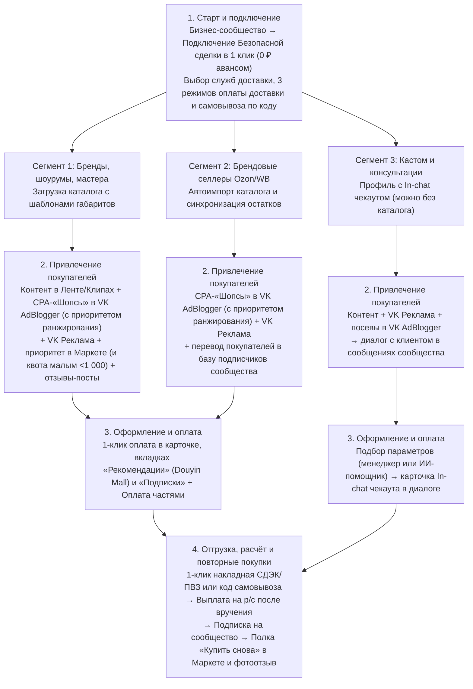

# Стратегия развития социальной коммерции для бизнес-сообществ ВКонтакте

## Краткое резюме стратегии

ВКонтакте занимает уникальную позицию на российском рынке: это площадка **прямых продаж брендовых и авторских товаров через контент, рекомендации блогеров и прямое общение с аудиторией**. В отличие от классических маркетплейсов, где продавцы конкурируют преимущественно ценой и не имеют доступа к базе покупателей, ВКонтакте позволяет бизнесу выстраивать собственный бренд, сохранять маржу и возвращать клиентов на повторные покупки.

Чтобы кратно увеличить число бизнесов с подключёнными инструментами продаж и количество заказов внутри платформы, стратегия объединяет пять решений:

1. **Разделение двух контуров продаж.** Массовые однотипные товары с низким чеком (~1 000 ₽) остаются во внешнем контуре партнёрского маркетплейса, а внутри ВКонтакте развиваются прямые продажи **брендовых и авторских товаров** в пяти приоритетных категориях (средний чек ~3 800 ₽).
2. **Обновление вкладки «Маркет ВКонтакте» по модели Douyin Mall.** Обычная новостная лента ВКонтакте сохраняется без перегрузки, а Маркет пересобирается в **две вкладки** («Рекомендации» — основная лента с товарами подписок, рекомендациями по интересам, товарами из просмотренных Клипов и Ленты, полкой повторных покупок — и «Подписки» без рекомендаций), с тумблером **«Только товары бизнес-сообществ ВКонтакте»** (включён по умолчанию) и чёткой маркировкой пяти типов карточек (включая `VK × Ozon` и `Ozon`).
3. **Подключение оплаты и доставки в 1 клик.** Вместо покупки и сложной ручной настройки собственной онлайн-кассы бизнес в 1 клик подключает **Безопасную сделку с агентским чеком от VK** за комиссию **2–4%** только с выкупленных заказов, а также **автоматическую доставку** (СДЭК, Почта России, Boxberry) с самовывозом по коду и **оформление заказа прямо в чате**.
4. **Открытие CPA-инструмента «Шопсы» для собственных магазинов VK.** Текущий механизм «Шопсов» в `VK AdBlogger` для внешнего маркетплейса сохраняется без изменений, а **тот же функционал переносится в интерфейс карточки товара для бизнес-сообществ ВКонтакте** с **приоритетом в ранжировании** для собственных магазинов VK.
5. **Диверсификация доходов VK помимо рекламы.** Новую выручку формируют комиссия за Безопасную сделку (`2–4%`) с условным возвратом части комиссии в рекламу за скорость отгрузки и рост оборота, «Оплата частями» под высокий средний чек, подписка на автоматизацию и ИИ-помощника в сообщениях, логистический шлюз и сервисный сбор в «Шопсах».

---

## 1. Исходная ситуация: ключевые цифры

Ежемесячная аудитория ВКонтакте составляет **93 млн человек**, а сервисы экосистемы VK охватывают **97% пользователей рунета** ([презентация VK за 3 кв. 2026 г.](https://corp.vkcdn.ru/media_s3/corp-site-prod/files/rus_results_presentation_q3_2026.pdf)). Выручка холдинга за 2025 год достигла **160 млрд ₽**, из них **37,7 млрд ₽** принесла реклама малого и среднего бизнеса ([пресс-релиз VK по МСФО за 2025 г.](https://vk.company/ru/press/releases/12255/)). При этом прямая выручка от социальной коммерции составила всего **1,3 млрд ₽** ([Интерфакс](https://www.interfax.ru/business/1078767)) — менее `1%` оборота холдинга, хотя товарный контент собирает десятки миллиардов просмотров ([блог ВКонтакте](https://m.vk.ru/press/shops-2025)).

Месячные данные платформы фиксируют четыре ключевых ограничения:

1. **Высокий чек внутри VK, но почти полное отсутствие онлайн-оплат.** За месяц товары во ВКонтакте увидели **66,6 млн человек**. Через партнёрский маркетплейс (прообраз — интеграция с Ozon) оформлено **4,93 млн заказов** на **5,12 млрд ₽** (средний чек — **1 039 ₽**). Через собственный чекаут ВКонтакте оформлено **413,7 тыс. заказов** на **1,56 млрд ₽** со средним чеком **3 781 ₽** — в **3,6 раза выше**, чем у партнёра. Однако из этих 413,7 тыс. оформленных через корзину заказов **онлайн внутри VK оплачены только 4 903 (`1,19%`)** — остальные `98,81%` уходят в переписки, на внешние ссылки или в отмены *(показатель `3 781 ₽` отражает средний чек всех оформленных через корзину заказов, а не только оплаченных онлайн)*.
2. **Высокий порог подключения оплаты и доставки.** Среди товарных бизнес-сообществ (`4 055` в выборке) товары загрузили `99,6%`, корзину включили `92,1%`, но **доставку подключили лишь `19,3%`**, **онлайн-оплату — `5,1%` (`206` групп)**, а **обе функции одновременно — всего `2,4%` (`97` групп)**. Причины и следствия подтверждены проверкой официальной документации, интерфейсов и данных:
   * для автоматической отправки чеков по закону 54-ФЗ ИП и компании обязаны отдельно арендовать и настраивать через XML-файлы **единственную поддерживаемую облачную кассу — АТОЛ Онлайн** ([справка VK Pay 40012](https://id.vk.ru/about/faq/business/vkpay/fiscalization/40012), [40013](https://id.vk.ru/about/faq/business/vkpay/fiscalization/40013)), что требует **32–45 тыс. ₽ в первый год авансом** (аренда кассы, фискальный накопитель и ОФД по [тарифам АТОЛ Онлайн](https://online.atol.ru/)), независимо от объёма продаж; любую другую уже имеющуюся у бизнеса кассу штатно подключить нельзя;
   * в VK Pay отсутствует защита покупателя (удержание оплаты до получения посылки): ИП и ООО получают деньги на 3-й рабочий день после оплаты, а самозанятые — сразу на кошелёк ([справка VK Pay 40005](https://id.vk.ru/about/faq/business/vkpay/how_does_it_work/40005), [40006](https://id.vk.ru/about/faq/business/vkpay/how_does_it_work/40006));
   * без заполненных точных габаритов и веса товара расчёт доставки отключается (покупатель видит сообщение *«Стоимость уточняйте у продавца»*), а официальная инструкция «Магазина 2.0» предлагает договариваться об оплате в сообщениях и вручную копировать трек-номер ([инструкция VK по доставке](https://vk.ru/@business-instrukciya-po-dostavke)); при этом ручная проверка доставки СДЭК в интерфейсе показала, что даже после заполнения габаритов и выбора ПВЗ стоимость остаётся в статусе «оплачивается отдельно» без указания срока доставки;
   * среди сообществ с подключённым чекаутом и активными товарами подключённая доставка сопровождается ростом доли бизнесов с заказами в `1,8–3,3` раза (`17,1%` против `5,2%` без оплаты и `17,0%` против `9,4%` при подключённой оплате), тогда как одна онлайн-оплата без доставки устойчивого роста заказов не даёт;
   * на товарах от `5 000 ₽` наблюдается резкий спад конверсии: в `5` из `6` сопоставимых групп малых и средних сообществ доля бизнесов с заказами минимальна (например, при средней аудитории и крупном каталоге падает с `26,8%` при цене `1 000–4 999 ₽` до `8,8%` при цене `≥5 000 ₽`), что подтверждает барьер доверия и потребность в Безопасной сделке и «Оплате частями».
3. **Слабая роль текущей Главной Маркета.** Главная страница Маркета даёт всего **`0,2%`** открытий карточек собственных магазинов (`412,8 тыс.` из `193,5 млн`) и **`0,1%`** открытий карточек партнёра (`88,4 тыс.`), при средней дневной аудитории витрины `127,4 тыс.` человек. Основной трафик приходит через **витрину сообщества (`39,1%`)**, **Ленту и Клипы (`18,6%` у своих магазинов и `92,7%` у партнёра)**, а также переходы из сообщений, историй и ссылок (`40,2%`).
4. **Дисбаланс контентного продвижения.** Посты с товарами публикуют лишь `4,5%` товарных сообществ, клипы — `1,6%`, а вовлечённость (лайки к просмотрам) у товарных публикаций в **2,6 раза ниже**, чем у обычных. При этом в [VK AdBlogger](https://adblogger.vk.ru/shops) уже работает CPA-механика **«Шопсы»** (`>135 тыс.` авторов, оплата процентом с продаж, 20-дневная проверка возвратов, программа образцов «Вернём траты», автомаркировка рекламы), но она подключена **только к каталогу Ozon** и недоступна бизнес-сообществам VK.

---

## 2. Место ВКонтакте на рынке (Вопрос 1)

> **Позиционирование:** ВКонтакте — **ведущая в России легальная платформа прямых продаж брендовых и авторских товаров (D2C) через контент, рекомендации авторов и живое сообщество**, где бизнес контролирует цену, маржу и прямую связь со своими покупателями.

| Канал продаж | Сильные стороны канала | Конкурентное преимущество ВКонтакте |
| :--- | :--- | :--- |
| **Маркетплейсы (Ozon, Wildberries)** | Сформированный поисковый спрос, склады и пункты выдачи в шаговой доступности. | На маркетплейсах растёт комиссионная нагрузка (сервисная выручка Ozon в 2025 г. росла в `1,7 раза` быстрее оборота `1,45 раза` — [отчёт Ozon](https://ir.ozon.com/ru/sth/ozon-obyavlyaet-finansovye-rezultaty-za-chetvertyy-kvartal-2025-goda-i-2025-god-18833bbf); комиссии в одежде достигают `27%` на Ozon и выше на WB без учёта логистики), высокая ценовая конкуренция однотипных карточек и **закрытая база покупателей**. ВКонтакте даёт прямой доступ к аудитории, контроль цены и низкую комиссию (`2–4%`). |
| **Классифайд (Авито)** | Высокий спрос (более половины сделок — новые товары, есть «Авито Молл» и Авито Доставка). | На Авито формат ограничен карточками объявлений без брендового контента и комьюнити, а на тарифе «за сделку» (`2–13%`) правила площадки запрещают уводить покупателя в собственную базу ([тарифы Авито](https://www.avito.ru/business/tariffs)). ВКонтакте позволяет раскрывать ценность товара через видео, посты и обзоры, продавать на высокий чек (`3 781 ₽`) и растить свою базу подписчиков. |
| **Мессенджер (Telegram)** | Высокая вовлечённость подписчиков, `0%` комиссии мессенджера на **физические** товары через сторонние шлюзы ([Bot Payments](https://core.telegram.org/bots/payments)) — при этом продавец отдельно оплачивает эквайринг (`~1,5–2,8%`) и свою онлайн-кассу (`32–45 тыс. ₽/год`). | В Telegram **нет алгоритмической ленты рекомендаций** для бесплатного привлечения новых покупателей, нет встроенной доставки, а официальная реклама для ИП и ООО в РФ закупается через посредников (от `250 €` + ~`20%` комиссия + НДС `22%`). Кроме того, ноябрьская волна блокировок ботов вокруг **Telegram Stars** (для цифровых товаров под давлением Apple и Google) показала зависимость платформы от правил зарубежных сторов. |
| **Зарубежные соцсети (Instagram\*, YouTube)** | Привычка аудитории к визуальным обзорам и рекомендациям блогеров. | С **1 сентября 2025 г.** в РФ действует запрет любой рекламы и бартерных интеграций в Instagram\* (**72-ФЗ**, штрафы для юрлиц `100–500 тыс. ₽` за публикацию — [разбор Forbes](https://www.forbes.ru/svoi-biznes/544859-zapret-reklamy-v-instagram-s-1-sentabra-cto-mozno-i-nel-za-publikovat)). В РФ у этих площадок нет встроенного чекаута и доставки, а доступ ограничен блокировками. ВКонтакте полностью легален, охватывает `97%` рунета и объединяет Клипы, VK Видео, посты и покупку в одном окне. |
| **Свой сайт (Tilda) и специализированные площадки (Flowwow)** | На сайте `0%` комиссии площадки (плюс свой эквайринг `~1,5–2,8%` и касса `32–45 тыс. ₽/год`), на Flowwow готовый подарочный спрос. | Своему сайту требуется постоянная закупка внешнего трафика и отдельное обслуживание платёжной инфраструктуры ([тарифы Tilda](https://tilda.cc/ru/pricing/)). На Flowwow действуют двузначные комиссии с каталога + `2,5%` и НДС ([тарифы Flowwow](https://flowwow.com/blog/komissiya-na-flowwow-kak-menyaetsya-logika-nachisleniya-i-tarify/)). ВКонтакте совмещает бесплатную витрину магазина с органическим и блогерским трафиком, а комиссия `2–4%` уже включает эквайринг, чек 54-ФЗ и защиту сделки. |

---

## 3. Целевые сегменты бизнеса и приоритетные категории товаров (Вопрос 2)

### 3.1. Приоритетные товарные категории

Стратегия фокусируется на **брендовых и авторских товарах с высокой вовлечённостью выбора** — категориях, где покупатель выбирает по дизайну, качеству, вкусу, отзывам и доверию к бренду, а не только по минимальной цене в поиске. По данным платформы (сопоставление открытий карточек, заказов, рекламных бюджетов и доли оригинального контента) выделяются **пять приоритетных категорий**:

| Приоритетная категория | Показатели в данных VK | Почему категория приоритетна для развития |
| :--- | :--- | :--- |
| **1. Гардероб** *(одежда, обувь, аксессуары)* | `#1` по открытиям карточек (`33,0 млн`), `#1` по расходам на рекламу в товарных группах («Мода и стиль»: `19,2 млн ₽/мес.`), `56,5%` оригинального контента; заказы через чекаут есть у `13,9%` активных сообществ от `1 000` подписчиков с публикациями (всего `29,0 тыс.` заказов, конверсия `0,09%`). | Максимальный нереализованный потенциал: огромный спрос и рекламные бюджеты, которые конвертируются в заказы после запуска 1-клик оплаты, доставки, фото-отзывов и «Оплаты частями». |
| **2. Продукты питания** *(гастрономия, кондитерские, кофе/чай, фермерские товары)* | `#1` по заказам внутри VK (`195,4 тыс.` заказов, или `44,9%` категорийного объёма); в тематике «Кулинария и еда» заказы через чекаут есть у **`29,9%`** активных сообществ от `1 000` подписчиков с публикациями (`1 181` чекаут-заказ в выборке). | Высокая частота **повторных покупок** (основа полки «Купить снова» в Маркете) и выраженная локальная география, для которой оптимален **самовывоз по коду** с онлайн-оплатой. |
| **3. Хобби, развлечения и авторские изделия** *(хендмейд, творчество, подарки)* | `#2` по открытиям (`32,0 млн`) и `#2` по заказам (`110,7 тыс.`, или `25,4%`); в тематике «Творчество и хендмейд» заказы через чекаут есть у **`22,0%`** активных сообществ от `1 000` подписчиков с публикациями и самая высокая доля оригинального контента (`66,5%`). | Самостоятельные бренды и авторские товары, которые сложно продавать в ценовой конкуренции маркетплейсов; максимальный эффект от **Безопасной сделки** и **In-chat чекаута**. |
| **4. Дом и дача** *(декор, текстиль, посуда, локальная мебель)* | `26,2 млн` открытий и `36,0 тыс.` заказов; высокий рекламный спрос («Дом и ремонт»: `4,4 млн ₽/мес.`). | Визуальная категория с высоким средним чеком, хорошо продаётся через обзоры, Клипы, доставку в 1 клик и «Оплату частями». |
| **5. Красота и здоровье** *(авторская и локальная косметика, уход)* | `11,3 млн` открытий и `13,0 тыс.` заказов в Маркете VK; при этом у партнёра категория даёт `1,24 млн` заказов при отношении заказов к открытиям карточки `8,8%`. | Доказанный контентный спрос; ключевая категория для запуска **CPA-«Шопсов»** с авторами и регулярных повторных заказов. |

Массовые товары повседневного спроса без выраженного бренда (расходники, мелкая электрофурнитура и т.п. со средним чеком `~1 000 ₽`) остаются во внешнем контуре партнёрского маркетплейса.

### 3.2. Три целевых сегмента бизнес-сообществ

1. **Российские бренды, локальные шоурумы и авторские мастерские.**  
   *Потребности и барьеры:* хотят продавать напрямую без двузначных комиссий маркетплейсов и растить постоянную базу клиентов, но сталкиваются с расходами на онлайн-кассу (`32–45 тыс. ₽/год`), ручным оформлением доставки и низкими охватами товарных публикаций.
2. **Брендовые продавцы с Ozon и Wildberries (собственные марки и оригинальные линейки).**  
   *Потребности и барьеры:* ищут независимый прямой канал продаж ради сохранения маржи и собственной клиентской базы на фоне роста комиссий маркетплейсов и запрета рекламы в Instagram\* по 72-ФЗ; им нужны автоматическая синхронизация каталога, прозрачная аналитика и работа с блогерами с оплатой за реальный заказ (CPA).
3. **Магазины с индивидуальными и консультационными заказами (в том числе сообщества без витрины).**  
   *Потребности и барьеры:* среди сообществ без каталога уже есть `108` рекламодателей с бюджетом **18,86 млн ₽/мес.** (товары по меркам, торты, букеты, подбор комплектации). Им требуется инструмент, позволяющий закрывать согласованную в переписке сделку на безопасную онлайн-оплату за один клик.

### 3.3. Приоритеты запуска по размеру аудитории

* **Основной фокус запуска — активные товарные сообщества с `1 000–9 999` подписчиков и публикациями** (`1 154` сообщества в выборке): заказы через чекаут зафиксированы у **`10,8%`** из них — ассортимент, регулярный контент и ядро аудитории уже сформированы, но внутреннее оформление заказа пока использует небольшая доля бизнесов.
* **Отдельная поддержка — активные товарные сообщества до `1 000` подписчиков** (заказы через чекаут есть у **`3,1%`**): для них выделяется небольшая доля показов в рекомендациях Маркета, помогающая находить первых покупателей за пределами собственной аудитории.
* Указанные группы задают приоритеты запуска, обучения и поддержки, а не ограничения доступа в Маркет; отсутствие заказов через чекаут само по себе не исключает продаж в переписке или других каналах.

---

## 4. Новая роль Маркета ВКонтакте — модель Douyin Mall (Вопрос 4)

### Персональная витрина отложенных и повторных покупок

В Китае видеоплатформа **Douyin** столкнулась с тем, что пользователи видят интересный товар в коротком ролике, сохраняют или лайкают его, но готовы купить позже — когда найти исходное видео уже сложно. Перестройка вкладки **Mall** (в глобальном TikTok — **Shop Tab**) в персональную витрину отложенных и повторных покупок позволила перевести в неё более **40% всего торгового оборота площадки** ([36Kr](https://eu.36kr.com/en/p/3480136952077441), [KrASIA](https://kr-asia.com/douyin-reshapes-strategy-to-cut-merchant-costs-as-gmv-grows)).

Обычная новостная лента ВКонтакте при этом остаётся без изменений, а вкладка «Маркет ВКонтакте» перестраивается по следующей архитектуре:

1. **Две вкладки внутри Маркета:**
   * **«Рекомендации»** *(основная лента по модели Douyin Mall / TikTok Shop Tab)* — объединяет товары сообществ из подписок, рекомендуемые товары новых бизнес-сообществ по интересам (с выделенной квотой показов для релевантных новых и малых магазинов `<1 000` подписчиков), товары, которые пользователь смотрел или лайкал в Ленте и Клипах, а также блок повторных покупок **«Купить снова»** (регулярные товары: продукты, кофе, косметика, товары для животных).
   * **«Подписки»** — строго товары и новинки бизнес-сообществ, на которые пользователь подписан, **без** алгоритмической ленты рекомендаций.
2. **Тумблер «Только товары бизнес-сообществ ВКонтакте» (в шапке основной ленты, включён по умолчанию):**
   * **При включённом тумблере (по умолчанию):** отображаются исключительно товары бизнес-сообществ VK (включая сообщества с интеграцией Ozon Seller); чисто озоновские карточки (опубликованные от общего сообщества Ozon без собственного бизнес-сообщества VK) скрыты.
   * **При выключенном тумблере:** к выдаче дополнительно добавляются и чисто озоновские карточки.
3. **Пять типов карточек и их визуальная маркировка (в Маркете и Клипах):**  
   Чтобы пользователь до клика видел способ оформления и отличал покупку внутри VK от перехода на внешнюю площадку, вводятся пять понятных значков и сценариев кнопок:
   * **Мгновенная покупка внутри VK** — фирменный значок быстрой покупки и защиты сделки VK *(кнопка «Заказать через VK», высший приоритет в выдаче)*.
   * **Оформление через чат с защитой (In-chat чекаут, модель WeChat)** — отдельный значок защищённого оформления в диалоге.
   * **Живое сообщество с интеграцией Ozon Seller** — значок **`VK × Ozon`** *(показывает, что это живое бизнес-сообщество ВКонтакте, но покупка завершается на стороне Ozon)*.
   * **Карточка без чекаута** — нейтральный маркер и явная пометка об отсутствии подключённых условий оплаты и доставки *(кнопка «Написать продавцу»)*.
   * **Чисто озоновская карточка (без сообщества VK)** — значок **`Ozon`** *(используется в Клипах/«Шопсах» и в Маркете при выключенном тумблере)*.
4. **Поиск, фильтры и обновлённая карточка товара и магазина:**
   * **Поиск по всему Маркету сразу:** поиск по названию товара ищет по всем вкладкам одновременно без переключения между ними, отдавая приоритет наверху выдачи нативным бизнес-сообществам VK с Безопасной сделкой и автодоставкой. На персональные полки отбираются активные сообщества с оригинальным контентом (у VK уже работает модель оценки оригинальности), отзывами и подключённой защитой сделки.
   * **Фильтры и быстрый режим:** доступны фильтры по категории, цене и способу получения, а также быстрый фильтр **«Только быстрая покупка»**, оставляющий только товары с мгновенной онлайн-оплатой и доставкой внутри VK.
   * **Информативная карточка товара и магазина:** карточка товара сразу отображает **наличие**, **конкретный способ доставки или самовывоз**, **стоимость и сроки** (если известны) и **способ оплаты**; блок о магазине включает **короткое описание бренда** (одного названия сообщества недостаточно), **обычное время ответа**, **подтверждённые отзывы** и **количество заказов** (при достоверном учёте). Если доставка или оплата не настроены, это явно обозначается в карточке до нажатия кнопки.

---

## 5. Инструменты для бизнеса и управление возвратами (Вопрос 3)

### 5.1. Оформление, оплата и доставка заказа

1. **Агентская фискализация и Безопасная сделка в 1 клик (через РНКО VK)**  
   *Как сейчас:* чтобы принимать онлайн-оплату с автоматическими чеками, ИП или компании нужно заранее оплатить аренду облачной кассы АТОЛ Онлайн, фискальный накопитель и ОФД (`32–45 тыс. ₽` за первый год по [тарифам АТОЛ Онлайн](https://online.atol.ru/)) и вручную прописать XML-настройки, а любую другую уже имеющуюся кассу подключить штатно нельзя.  
   *Как станет:* продавец в 1 клик подключает приём платежей по агентскому договору через собственную расчётную организацию VK — **РНКО «ВК Платёжные решения»** — за **0 ₽ фиксированных затрат** и комиссию **2–4%** только с выкупленного заказа.
   * В момент оплаты деньги покупателя замораживаются на **транзитном агентском счёте РНКО** (Безопасная сделка / эскроу).
   * VK как агент **автоматически пробивает чек по 54-ФЗ** с указанием ИНН продавца (для самозанятых чек передаётся автоматически в «Мой налог»).
   * После получения статуса «Вручено» от службы доставки (или подтверждения кодом самовывоза) деньги за вычетом комиссии автоматически перечисляются на **расчётный счёт** (для ИП и ООО) или через СБП (для самозанятых). Аналогичная агентская модель действует на Ozon и Flowwow ([Т-Банк о 54-ФЗ](https://secrets.tbank.ru/voprosy-otvety/nuzhna-li-onlayn-kassa-marketpleysu/), [Flowwow](https://flowwow.com/blog/s-kak-selleram-uchityvat-vyplaty-ot-flowwow/)).

2. **Единая логистическая интеграция в 1 клик и самовывоз по коду**  
   VK интегрирует по API ключевые службы доставки (СДЭК, Почта России, Boxberry / 5Post) без капитальных затрат на собственные склады и ПВЗ. При создании товара продавец указывает адрес отправки и выбирает **готовый шаблон габаритов** по категории (коробка S / M / L) — стоимость доставки рассчитывается автоматически для адреса покупателя. Накладная со штрих-кодом печатается в 1 клик из заказа, а трек-номер и статусы обновляются автоматически.  
   Продавцу доступны **три режима оплаты доставки**:
   * **Оплата покупателем** — автоматический расчёт тарифа на этапе оформления;
   * **Оплата продавцом** (включено в цену товара) — карточка получает бейдж *«Бесплатная доставка»*, повышающий конверсию;
   * **Бесплатная доставка от порога суммы заказа** (например, от 4 000 ₽) — инструмент увеличения среднего чека.  
   Для локального бизнеса (шоурумы, кондитерские, мастерские) действует **онлайн-оплата с самовывозом по 4-значному коду**: ввод кода при выдаче подтверждает получение товара и размораживает выплату продавцу.

3. **Оформление заказа прямо в чате (In-chat чекаут — модель WeChat)**  
   Для товаров, требующих подбора размера или индивидуальных параметров, продавец после согласования деталей в переписке одной кнопкой отправляет прямо в диалог **интерактивную карточку оплаты** с итоговой ценой, выбором ПВЗ и Безопасной сделкой. На карточке товара в витрине отображается понятный бейдж **«Оформление в чате · Безопасная сделка VK»**, заранее снимающий у покупателя сомнения в безопасности оплаты.

### 5.2. Инструменты продвижения и роста продаж

4. **Открытие CPA-«Шопсов» (`VK AdBlogger`) для бизнес-сообществ VK с приоритетом в ранжировании**  
   *Как сейчас:* в [VK AdBlogger](https://adblogger.vk.ru/shops) уже работает удобная и полностью автоматизированная система «Шопсов» с оплатой блогеру за реальный заказ (`>135 тыс.` авторов, автомаркировка рекламы `erid`, программа бесплатных образцов «Вернём траты», 20-дневная проверка возвратов и массовые выплаты через `cashout.vk.ru`). Однако **сейчас бизнес-сообщества ВКонтакте не могут ею пользоваться** — это привилегия интеграции с внешним маркетплейсом (Ozon), тогда как собственным магазинам VK доступны лишь предоплатные «Посевы» и «Контент на заказ».  
   *Как станет:* текущий механизм «Шопсов» для Ozon сохраняется без изменений, а **точно такой же функционал переносится прямо в интерфейс создания карточки товара для бизнес-сообществ ВКонтакте**. Продавец с подключённой Безопасной сделкой и доставкой сам задаёт процент от цены выкупленного товара автору и платит только за подтверждённые заказы. При этом бизнес-сообщества VK получают **приоритет в ранжировании «Шопсов»** (показываются чаще карточек внешнего маркетплейса — с калибровкой коэффициента приоритета на пилоте через A/B-тест, ориентир `+20–30%` к охвату). За счёт большего охвата и высокого среднего чека внутри VK (`3 781 ₽` против `1 039 ₽` у партнёра) магазин VK может устанавливать более низкий процент вознаграждения (например, `10%` вместо `15%`), обеспечивая при этом блогеру сопоставимый или более высокий заработок в рублях (`~378 ₽` против `~156 ₽` с заказа).

5. **Отзывы-посты покупателей в карточке товара (модель Xiaohongshu)**  
   После подтверждённого выкупа покупатель получает предложение опубликовать фото- или видеоотзыв с привязкой к карточке товара. Подтверждённые отзывы отображаются прямо внутри карточки (укрепляя доверие при среднем чеке `3 781 ₽`) и органически попадают в рекомендации. По желанию продавец может самостоятельно включить в настройках магазина **добровольный промокод на повторный заказ** за фотоотзыв (по модели «Баллов за отзывы» — скидка предоставляется за счёт самого продавца и работает на возврат клиента, без субсидий со стороны VK).

6. **Контекстные подсказки роста для продавцов**  
   После накопления статистики на пилотных когортах платформа показывает продавцам точечные подсказки в момент настройки: например, при незаполненных габаритах товара — оценку роста заказов в данной категории после включения авторасчёта доставки; при регулярных вопросах покупателей о доставке в сообщениях — быстрый переход к подключению Безопасной сделки в 1 клик.

### 5.3. Система управления возвратами

При переходе от ручных переводов без гарантий к удобной онлайн-оплате с защитой покупателя пользователи смелее заказывают товары дистанционно — особенно в приоритетной категории **«Гардероб»**. Вместе с ростом заказов естественным образом увеличивается число дистанционных отказов и возвратов («не подошёл размер, оттенок или посадка»). Чтобы защитить маржу малого бизнеса от потерь на обратной логистике и недобросовестных возвратах, в систему встроены четыре механизма контроля:

1. **Профилактика возвратов до оплаты (модели Xiaohongshu и WeChat):** реальные фотоотзывы покупателей внутри карточки, структурированные таблицы размеров и быстрая консультация в чате перед оплатой снижают долю ошибок при выборе.
2. **Честное распределение стоимости обратной пересылки:** в соответствии со ст. 26.1 Закона «О защите прав потребителей» возврат при браке или ошибке продавца бесплатен для покупателя, а при отказе от качественного товара («не подошло / передумал») продавец вправе удержать стоимость обратной доставки из суммы возврата (с опцией недорогой добровольной страховки обратной пересылки при чекауте, как в китайских сервисах).
3. **Защита от потерь на комиссиях и выплатах авторам:** вознаграждение блогеру в «Шопсах» начисляется **только через 20 дней после вручения заказа** — при возврате выплата автору равна `0 ₽` (механика уже работает в VK AdBlogger). Комиссия VK за Безопасную сделку при отмене или возврате возвращается продавцу за вычетом минимального технического сбора (по модели [TikTok Shop US](https://seller-us.tiktok.com/university/essay?knowledge_id=5988482086864682)).
4. **Осмотр при получении в ПВЗ и самовывозе:** отказ фиксируется в момент выдачи по API службы доставки (или при самовывозе), после чего деньги сразу возвращаются покупателю с транзитного счёта РНКО без затяжных споров.

---

## 6. Опора на китайские и международные практики

| Элемент стратегии ВКонтакте | Международный / китайский прототип | Подтверждённый эффект и адаптация под РФ |
| :--- | :--- | :--- |
| **Персональная витрина отложенных и повторных покупок** (Маркет VK) | **Douyin Mall / TikTok Shop Tab** | Возвращает зрителей коротких видео к отложенным и повторным заказам (`>40%` оборота Douyin — [36Kr](https://eu.36kr.com/en/p/3480136952077441)). |
| **CPA-«Шопсы» для бизнес-сообществ** (в карточке товара + приоритет ранжирования) | **TikTok Shop Affiliate / Douyin** | Переносит готовый движок `VK AdBlogger /shops` с 20-дневным холдом и образцами в карточку магазина VK при минимальных затратах на запуск. |
| **In-chat чекаут** (карточка оплаты и доставки в диалоге) | **WeChat Mini Programs** (Китай, `>1,4 млрд` MAU — [Tencent](https://www.tencent.com/products/weixin-wechat/)) | Переводит консультационные сделки из личных сообщений в защищённую онлайн-оплату (`98,81%` оформленных заказов VK сейчас не оплачиваются онлайн). |
| **Брендовые категории с высоким чеком (`3 781 ₽`) и UGC-отзывы** | **Xiaohongshu / RED** (Китай) | Повышает доверие при дорогой покупке за счёт реальных фотоотзывов покупателей и снижает возвраты. |
| **Агентский чек + эскроу до вручения + 1-клик накладная** | **TikTok Shop Settlement / Alipay Escrow + API SF Express** | Расчёт после вручения ([TikTok Shop US](https://seller-us.tiktok.com/university/essay?knowledge_id=5982454398175018)) защищает покупателя, а API доставки убирает ручную работу с трек-номерами. |
| **Условный возврат части комиссии на рекламу** (за скорость отгрузки и рост оборота) | **Ad-credit rebates** (Douyin / TikTok Shop) | Стимулирует соблюдение сроков отгрузки (≤48 ч) и вовлекает бизнес в платное продвижение без снижения текущих рекламных доходов. |

---

## 7. Целевой путь бизнеса (CJM) с развилками по сегментам (Вопрос 5)

Путь предпринимателя начинается с быстрого единого старта (подключение Безопасной сделки и доставки за 15 минут без покупки кассы), а затем разветвляется по трём сегментам:

---

## 8. Монетизация, эффект для сторон и план внедрения

### 8.1. Модель не-рекламной монетизации

1. **Комиссия за Безопасную сделку (`2–4%` с выкупленного заказа).** Включает банковский эквайринг (`~1,5–2%` при самостоятельном подключении), автоматический чек по 54-ФЗ и защиту сделки. Для малого и начинающего бизнеса это **замена фиксированного стартового платежа на переменный**: при разнице ставки `~1–1,5%` сверх обычного эквайринга агентская схема напрямую дешевле собственной кассы (`32–45 тыс. ₽/год`) для всех магазинов с оборотом через VK **до ~2–3 млн ₽ в год** (`~170–250 тыс. ₽/мес.`), полностью убирая риск авансовых трат. Для более крупного бизнеса с оборотом выше этого порога ценность комиссии окупается ростом конверсии за счёт защиты сделки и отсутствием сложной ручной интеграции кассы.  
   *Условный рекламный кэшбэк:* до `25–30%` от удержанной комиссии платформы (порядка `0,5–1%` оборота при базовой ставке `3–4%`) может возвращаться на баланс VK Рекламы при одновременном соблюдении двух условий — отгрузка заказа в срок до 48 часов и использование бонуса как софинансирования (до `20–30%`) **новых** рекламных кампаний или прироста бюджета. Это сохраняет положительную маржу на каждой сделке и не снижает текущую рекламную выручку (`59,6 млн ₽/мес.` в выборке товарных сообществ).
2. **«Оплата частями» (рассрочка на 4 платежа без переплаты для покупателя).** Релевантна для высокого среднего чека ВКонтакте (`3 781 ₽`, а в одежде и товарах для дома — `5–15 тыс. ₽`), где по данным платформы при цене товара от `5 000 ₽` происходит резкий спад конверсии (в сопоставимых группах доля бизнесов с заказами падает в среднем в `~3` раза — например, с `26,8%` до `8,8%`). Магазин оплачивает партнёрскую комиссию (`3–5%`) за рост конверсии в дорогих товарах, а VK получает долю от комиссии финтех-партнёра.
3. **Подписка на автоматизацию продаж (B2B SaaS).** Базовая витрина и чекаут остаются бесплатными (`0 ₽`). По ежемесячной подписке предоставляются инструменты экономии времени: ИИ-помощник в сообщениях (отвечает по наличию/размерам и выставляет In-chat чекаут), автосинхронизация остатков с Ozon/WB/1С и сценарии напоминания о незавершённой корзине.
4. **Сервисный сбор в CPA-«Шопсах» и логистический шлюз.** Платформенный сбор с подтверждённых выкупленных заказов через `VK AdBlogger` и маржа между оптовым корпоративным тарифом VK у перевозчиков и розничным тарифом (при сохранении более низкой цены доставки для самого продавца).

### 8.2. Оценка эффекта для бизнеса и ВКонтакте

| Инструмент | Эффект для бизнеса | Эффект для ВКонтакте |
| :--- | :--- | :--- |
| **Безопасная сделка + агентский чек в 1 клик** | Нулевой порог входа вместо `32–45 тыс. ₽/год` авансом (прямо дешевле своей кассы при обороте до ~2–3 млн ₽/год), запуск за 15 минут, рост конверсии за счёт доверия покупателей. | Кратный рост доли сообществ с оплатой (с `5,1%`) и доли оплаченных онлайн заказов (с `1,19%`), новая транзакционная выручка (`2–4%`). |
| **Единая доставка (3 режима) + самовывоз по коду** | Отсутствие ручного ввода габаритов и трек-номеров; порог бесплатной доставки увеличивает средний чек. | Рост подключённой доставки (с `19,3%`), увязка заказа с ростом конверсии (`17,1%` против `5,2%` без доставки), автоматический статус «Вручено» для эскроу, маржа логистического шлюза. |
| **In-chat чекаут с бейджем** | Быстрое закрытие сложных и индивидуальных заказов прямо в переписке без потери клиента. | Перевод сделок из личных сообщений и сегмента `108` рекламодателей без каталога в измеримый оборот внутри VK. |
| **CPA-«Шопсы» для магазинов VK (`VK AdBlogger` в карточке)** | Привлечение покупателей через `135 тыс.+` авторов **без предоплаты** — оплата только за выкупленный заказ по более низкому `%` при сохранении дохода блогера в рублях. | Переключение спроса из Клипов внутрь экосистемы VK за счёт приоритета в ранжировании при минимальных затратах на запуск + сервисный CPA-сбор. |
| **Обновлённый Маркет (вкладки «Рекомендации» и «Подписки», тумблер, квота малым `<1 000`, новая карточка)** | Возврат зрителей Клипов к отложенным покупкам, выход малых магазинов (`3,1%` с заказами) за пределы своей базы, понятная карточка бренда и рост повторных заказов. | Рост дневной аудитории Маркета (с `127,4 тыс.`), рост доли повторных покупателей (с `19%` в сторону ориентира партнёра `26,6%`), стимул подключать чекаут для роста в выдаче. |
| **Оплата частями + B2B-подписка (ИИ-чат, автосинк)** | Преодоление спада конверсии на чеках от `5 000 ₽` (`3 800 ₽+`), сокращение ручной нагрузки на менеджеров. | Устойчивая не-рекламная выручка (финтех + регулярные подписки) и долгосрочное удержание брендовых продавцов. |

### 8.3. План внедрения и управление рисками

* **Этап 1 (0–3 месяца) — Базовая платёжная и логистическая инфраструктура:** агентский чек и Безопасная сделка через РНКО VK, шаблоны габаритов и 1-клик накладная (СДЭК, Почта России, Boxberry), самовывоз по коду, In-chat чекаут с бейджем, а также подтверждённые фотоотзывы в карточке и таблицы размеров (профилактика возвратов с первого дня). Пилотный запуск в приоритетных категориях (`Гардероб`, `Продукты питания`, `Хобби и авторские изделия`) с фокусом на активных сообществах `1 000–9 999` подписчиков и выделением квоты показов малым магазинам `<1 000`.
* **Этап 2 (3–6 месяцев) — Масштабирование спроса и обновление Маркета:** перенос функционала CPA-«Шопсов» `VK AdBlogger` в карточку товара бизнес-сообществ VK (с приоритетом в ранжировании), внедрение 5 типов визуальных значков карточек (`VK × Ozon`, `Ozon`, защита VK), перезапуск Маркета по модели **Douyin Mall** (вкладки «Рекомендации» и «Подписки», тумблер «Только товары бизнес-сообществ ВКонтакте», быстрый фильтр «Только быстрая покупка», поиск по всему Маркету сразу и обновлённая карточка товара и бренда), запуск контекстных подсказок на базе статистики пилота.
* **Этап 3 (6–12 месяцев) — Расширение не-рекламной выручки:** «Оплата частями», B2B-подписка (ИИ-помощник в сообщениях, автосинхронизация остатков с Ozon/WB/1С и сценарии напоминания о незавершённой корзине), органическое продвижение отзывов-постов в рекомендациях и условный рекламный кэшбэк за отгрузку в срок ≤48 часов.

**Ключевые риски и меры снижения:**
1. *Консерватизм части микропродавцов, привыкших к прямым переводам:* переход в защищённый чекаут обеспечивается экономическими стимулами (`0 ₽` авансом за кассу, 1-клик накладная, приоритет в Маркете, доступ к блогерам в `VK AdBlogger` и «Оплата частями»).
2. *Рост доли возвратов при упрощении онлайн-оплаты:* контролируется четырёхуровневой системой защиты (фотоотзывы и чат-консультация до оплаты, правило обратной доставки по ст. 26.1 ЗоЗПП, 20-дневный холд выплат блогерам и фиксация отказов в ПВЗ).
3. *Снижение текущих рекламных бюджетов из-за кэшбэка:* возврат части комиссии в рекламу ограничен долей от комиссии платформы (`до 25–30%`) и привязывается строго к приросту бюджетов / новым рекламодателям и соблюдению сроков отгрузки ≤48 часов.
